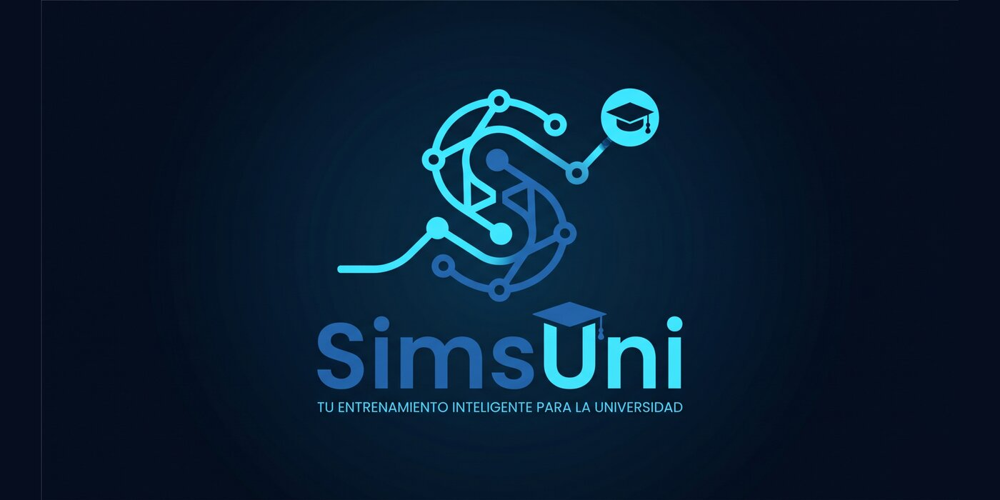
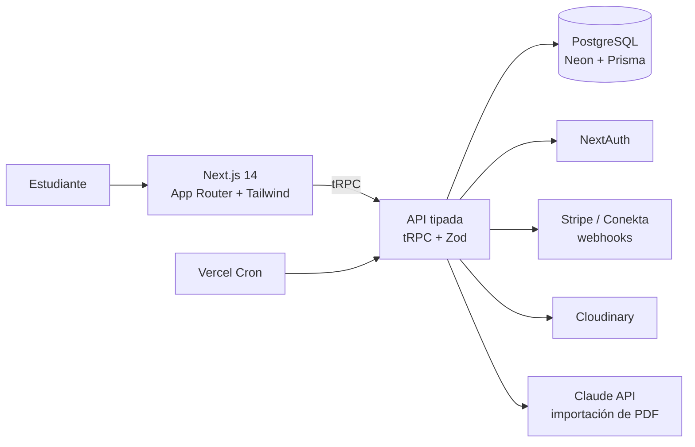
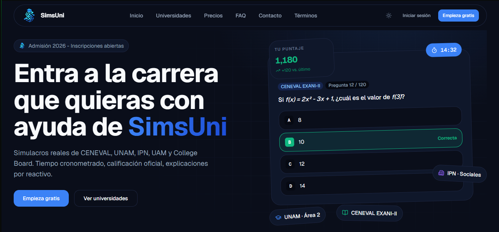

# SimsUni

**Plataforma de simulacros de exámenes de admisión universitaria en México**

-4169E1?style=flat-square&logo=postgresql&logoColor=white)

> 🔒 **El código fuente es privado.** Este repositorio es la vitrina pública del proyecto: qué hace, cómo está construido y dónde probarlo. Si eres reclutador o colaborador y quieres ver el código, [escríbeme](https://github.com/AdolfoHMtz).

---

## 🎯 ¿Qué es?

SimsUni ayuda a los aspirantes a la universidad a prepararse con **simulacros realistas**, con tiempo, puntaje y formato iguales a los del examen oficial. Tiene una arquitectura **multi-universidad** que cubre:

- **CENEVAL:** EXANI-I y EXANI-II (BUAP, UV, UADY, UAEH y muchas más).
- **Exámenes institucionales:** UNAM, IPN y UAM.
- **College Board:** PAA y PIENSE II.

## ✨ Funcionalidades

| | |
|---|---|
| 📝 **Motor de examen** | Temporizador sincronizado con el servidor, guardado automático, modo completo y modo corto |
| 📊 **Calificación por fórmula** | Aciertos, escala CENEVAL 700–1300 y College Board 400–1600 |
| 📈 **Resultados y progreso** | Desglose por sección, revisión de respuestas, historial, rachas y exportación a PDF |
| 📚 **Modo estudio** | Práctica guiada por tema (Premium) |
| 🏫 **Catálogo** | Filtrado por universidad, nivel y carrera, con 15 plantillas de examen |
| 👥 **Roles** | Estudiante, colaborador que redacta preguntas y administrador que modera |
| 🤖 **Importación con IA** | Extrae preguntas de guías en PDF con la API de Claude |
| ➗ **Matemáticas** | Fórmulas con KaTeX y barra de símbolos para redactar preguntas |
| 💳 **Monetización freemium** | Créditos por intento y suscripción Premium con **Stripe** y **Conekta** (OXXO) |
| 🌗 **Diseño propio** | Sistema de diseño con modo claro y oscuro, responsive para móvil |

## 🏗️ Arquitectura

- **Stack T3:** Next.js, tRPC, Prisma, NextAuth y Tailwind, con TypeScript de punta a punta.
- **Pagos idempotentes:** los webhooks validan la firma y aplican el beneficio dentro de una transacción.
- **Tareas programadas:** un cron diario cierra los intentos expirados.
- **Pruebas:** 17 suites de Vitest, entre ellas el cálculo de puntaje, las rachas, la autenticación y la validación del banco de preguntas.
- **Respaldos:** copia automática de la base de datos con GitHub Actions.
- **Investigación:** fichas de 38 exámenes de admisión 2026, con temarios, convocatorias y oferta de carreras de 14 universidades.

## 📸 Capturas

<!-- Agrega aquí capturas actuales de la app (landing, motor de examen, resultados).
     Súbelas a la carpeta assets/ y descomenta las líneas:

  
  
  

-->

👉 La mejor forma de conocerla es probarla: **[simuladorexam.vercel.app](https://simuladorexam.vercel.app)**

## 🗺️ Estado

- ✅ Autenticación, banco de preguntas, motor de examen, pagos, landing y despliegue
- ✅ Rediseño visual v2 y refactor completos
- 🔄 Cargando el banco de preguntas y preparando el lanzamiento

## 👨‍💻 Autor

**Adolfo Huerta**: idea, diseño y desarrollo full-stack.
[@AdolfoHMtz](https://github.com/AdolfoHMtz) · Puebla, México

© 2026 Adolfo Huerta. Todos los derechos reservados.
